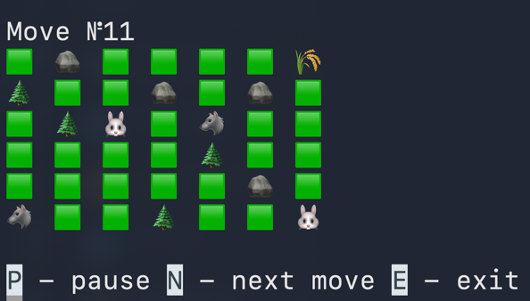
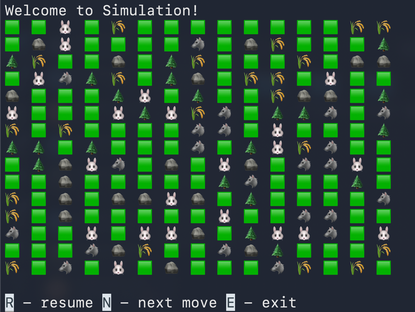

# Simulation by DarkRubin
GoLang implementation

### Description

Simple terminal game that simulates activity of creatures in bordered world. I created this project just to practice 
with features of Go language.

### Screenshots of application
Simulation with 7x6 world size



Simulation with 15x15 world size



### Try by yourself
You can start your own simulation, by run this command:
```shell
go run cmd/simulation/main.go
```

### Change setup
If you want to change default behavior of simulation, you can do any experiments by changing values 
in `config.yaml` file

For example, you can do map bigger, by set up higher numbers to `world_map.height` and `world_map.width` parameters

### Dependencies

Only dependency for this project, is `yaml/v4` the library to parse config file. It already included in `go.mod` file
